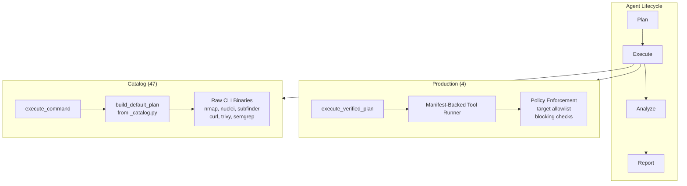
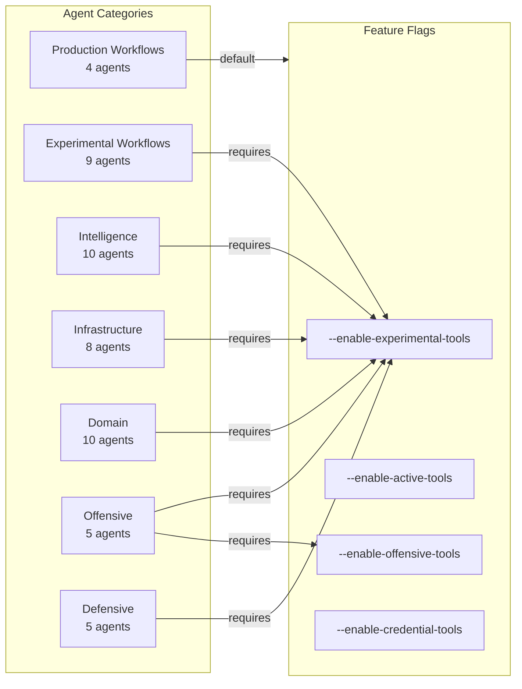

# Agents

ShikariMCP ships **51 agents** across **6 categories**. Four production workflow agents are exposed by default; the remaining 47 catalog agents are available behind `--enable-experimental-tools`.

---

## Execution Model

ShikariMCP has two agent tiers with different execution mechanisms:

| Tier | Agents | Execution | Gating | Plan Source |
|------|--------|-----------|--------|-------------|
| **Production** | `ReconAgent`, `PentestAgent`, `BugBountyAgent`, `WebAppWorkflowAgent` | `execute_verified_plan` (manifest-backed) | None — exposed by default | Inline in agent `plan()` method |
| **Catalog** | 47 agents: 9 experimental workflow + 10 intelligence + 8 infrastructure + 10 domain + 5 offensive + 5 defensive | `execute_command` (raw subprocess) | `--enable-experimental-tools` | `build_default_plan()` from `_catalog.py` |

All agents follow the same lifecycle: **Plan → Execute → Analyze → Report**. The difference lies in how the Execute phase runs:

- **Production agents** call `execute_verified_plan`, which resolves each step through the manifest-backed `run_verified_tool` pipeline. This enforces target allowlists, metadata-blocking policy checks, input dependency resolution (via `inputs_from`), and structured result handling.
- **Catalog agents** call `execute_command` directly on a raw command list. Plans are built by `build_default_plan()` in `src/shikari/agents/_catalog.py` and use real, widely-available CLI security binaries. Riskier steps are additionally gated by the agent category's capability opt-in flags (`--enable-offensive-tools`, `--enable-credential-tools`).

---

## Feature Flag Mapping

The following flags control which agent categories and capabilities are exposed:

| Flag | Unlocks |
|------|---------|
| _(none — default)_ | Production workflow agents (ReconAgent, PentestAgent, BugBountyAgent, WebAppWorkflowAgent) |
| `--enable-experimental-tools` | All 47 catalog agents (experimental workflows, intelligence, infrastructure, domain, offensive, defensive) |
| `--enable-active-tools` | Active network and vulnerability scanning tools within catalog agents |
| `--enable-offensive-tools` | Offensive capabilities (exploitation, payload generation, MITM, wireless) — required by Offensive category agents |
| `--enable-credential-tools` | Credential attack capabilities — required by credential-bearing steps |

**Scope note:** All 51 agents are currently annotated as `ToolScope.LOCAL` — they run CLI tools on the local machine and are unavailable in remote HTTP mode.

---

## Workflow Agents (13)

| # | Agent | Audience | Description |
|---|-------|----------|-------------|
| 1 | **ReconAgent** ⭐ | Red team, bug bounty | Full recon pipeline — passive → subdomains → DNS → ports → services |
| 2 | **PentestAgent** ⭐ | Red team, pentest | Complete pentest lifecycle — recon → vuln scan → exploit → report |
| 3 | **BugBountyAgent** ⭐ | Bug bounty | Subdomain → fuzzing → param mining → injection |
| 4 | **WebAppWorkflowAgent** ⭐ | Red team, bug bounty | Fingerprint → probe → crawl → templates → parameters |
| 5 | **CTFAgent** | CTF players | Identifies challenge type → selects tools → solves |
| 6 | **RedTeamAgent** | Red team | Full kill chain — access → privesc → lateral → persistence → exfil |
| 7 | **BlueTeamAgent** | Blue team | Defensive assessment — logs → detection gaps → hardening checks |
| 8 | **PurpleTeamAgent** | Purple team | Combined red+blue — attacks and validates detection capabilities |
| 9 | **IncidentResponseAgent** | Blue team, SOC | IR workflow — triage → containment → eradication → recovery |
| 10 | **ThreatHuntAgent** | Blue team, SOC | Proactive hunting — IOC search → behavioral analysis → YARA |
| 11 | **ComplianceAgent** | GRC, compliance | CIS, PCI-DSS, HIPAA, SOC2, ISO27001 auditing |
| 12 | **VulnManagementAgent** | Blue team, GRC | Vuln lifecycle — scan → prioritize → track → verify fix |
| 13 | **CodeReviewAgent** | DevSecOps | Source code security — SAST → secrets → dependencies → patterns |

> ⭐ = **Production agents** exposed by default. All others are catalog agents gated behind `--enable-experimental-tools`.

---

## Intelligence Agents (10)

| # | Agent | Description |
|---|-------|-------------|
| 1 | **CVEIntelAgent** | CVE lookup, exploit availability, severity scoring |
| 2 | **ExploitGenAgent** | Analyzes vulnerabilities → generates PoC exploits → tests |
| 3 | **VulnCorrelatorAgent** | Attack chain discovery — maps chained vulnerabilities |
| 4 | **ThreatIntelAgent** | OSINT, breach databases, APT TTPs, MITRE ATT&CK |
| 5 | **AttackSurfaceAgent** | Maps all external assets — subdomains, APIs, cloud |
| 6 | **ReportAgent** | Aggregates findings → executive and technical reports |
| 7 | **IOCExtractorAgent** | Extracts IOCs from scan outputs → structured feeds |
| 8 | **RiskScoringAgent** | Context-aware risk scoring with business impact |
| 9 | **ZeroDayResearchAgent** | Fuzzing, crash analysis, PoC development |
| 10 | **ThreatModelingAgent** | STRIDE/DREAD threat modeling |

---

## Infrastructure Agents (8)

| # | Agent | Description |
|---|-------|-------------|
| 1 | **DecisionEngine** | Selects optimal tool combination for a given objective |
| 2 | **ParamOptimizer** | Tunes parameters based on context |
| 3 | **RateLimiter** | Detects WAFs → adjusts speed and rotates |
| 4 | **FailureRecovery** | Diagnoses failures → retries with adjusted parameters |
| 5 | **PerformanceMonitor** | Monitors resources → throttles if needed |
| 6 | **ResourceScheduler** | Queue prioritization and concurrent execution |
| 7 | **HealthCheckAgent** | Checks tool installations and dependencies |
| 8 | **ConfigManager** | Scan profiles and environment presets |

---

## Domain-Specific Agents (10)

| # | Agent | Description |
|---|-------|-------------|
| 1 | **WebAppAgent** | Full web app testing — spider → inject → auth bypass |
| 2 | **NetworkAgent** | Network security — discovery → scan → exploit → traffic analysis |
| 3 | **CloudAgent** | Multi-cloud — IAM, storage, serverless, compliance |
| 4 | **MobileAgent** | Android and iOS — reversing, hooking, certificate pinning |
| 5 | **OSINTAgent** | Full OSINT — people → email → social → breach → dossier |
| 6 | **ActiveDirectoryAgent** | AD attacks — Kerberoast, delegation, BloodHound |
| 7 | **MalwareAgent** | Static and dynamic analysis, IOC extraction, YARA |
| 8 | **IoTSCADAAgent** | Firmware, MQTT/CoAP/Modbus, PLC enumeration |
| 9 | **WirelessAgent** | WiFi, Bluetooth, and RF analysis |
| 10 | **DatabaseAgent** | SQL/NoSQL injection, privilege escalation |

---

## Offensive Agents (5)

These agents additionally require `--enable-offensive-tools` to execute their steps.

| # | Agent | Description |
|---|-------|-------------|
| 1 | **PrivEscAgent** | Linux SUID/cron/kernel and Windows tokens/services/UAC |
| 2 | **LateralMovementAgent** | Pass-the-hash, PSExec, WMI, SSH pivoting, SOCKS |
| 3 | **EvasionAgent** | AV/AMSI/ETW bypass, obfuscation, process injection |
| 4 | **PayloadCraftAgent** | Shellcode, staged/stageless, multi-platform, C2 |
| 5 | **CredHarvestAgent** | Mimikatz, LSASS, SAM, Kerberos tickets, NTDS |

---

## Defensive Agents (5)

| # | Agent | Description |
|---|-------|-------------|
| 1 | **HardeningAgent** | OS benchmarks, service minimization, firewall rules |
| 2 | **ForensicsAgent** | Memory, disk, network, and log forensics |
| 3 | **MalwareTriageAgent** | Classification, hash lookup, YARA, sandbox, IOCs |
| 4 | **AnomalyDetectAgent** | Log analysis, network anomalies, behavioral alerts |
| 5 | **ContainmentAgent** | Network isolation, lockout, firewall, DNS sinkhole |

---

## Promoting Catalog Agents to Production

Catalog agents currently execute plans via `execute_command` (raw subprocess), which bypasses the manifest-backed policy engine. To promote a catalog agent to a production workflow:

1. **Rewrite the `execute()` method** to call `execute_verified_plan` instead of `execute_command`. This routes each step through `run_verified_tool`, enabling target allowlist enforcement, metadata-blocking checks, and structured result handling.
2. **Replace raw command lists** with manifest-backed tool references: each plan step should specify a `tool` identifier (e.g., `nmap_scan`) with structured `inputs` and optional `inputs_from` for cross-step data flow, rather than a raw `cmd` string.
3. **Update the tool registration** — change the `@shikari_tool` category from `agent_*` to `workflow` and remove the `is_experimental` quality so the agent is exposed by default.
4. **Remove the `--enable-experimental-tools` dependency** — the promoted agent will be available without any flag.

This migration path ensures that every promoted agent inherits the same policy enforcement, audit logging, and dependency resolution as the four default production agents.
