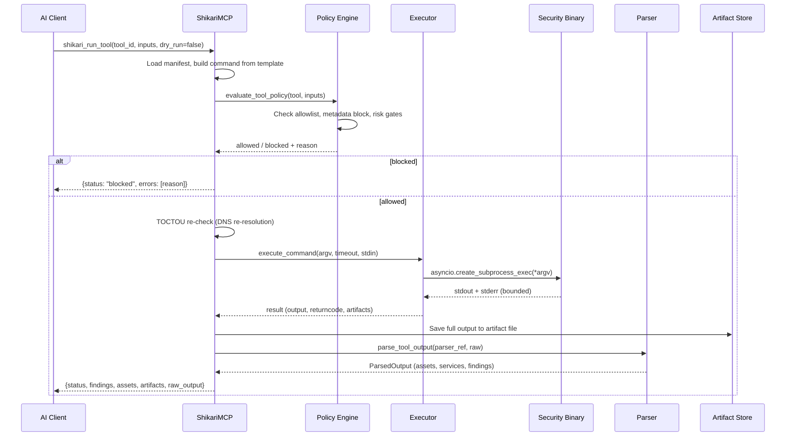
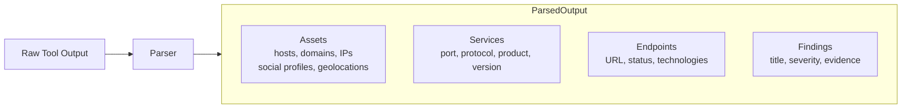
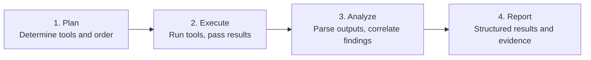
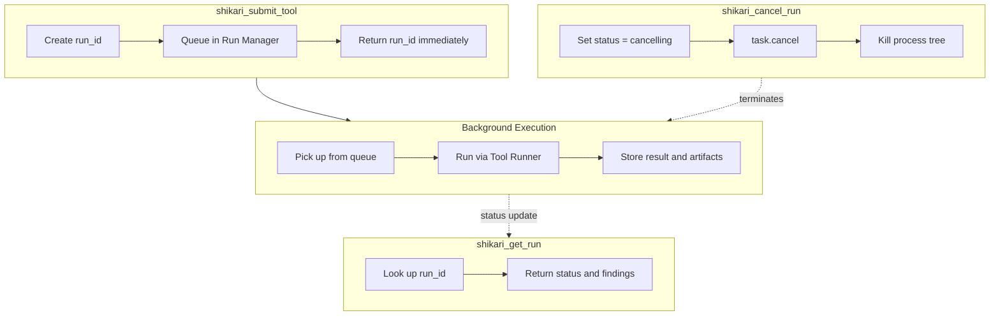
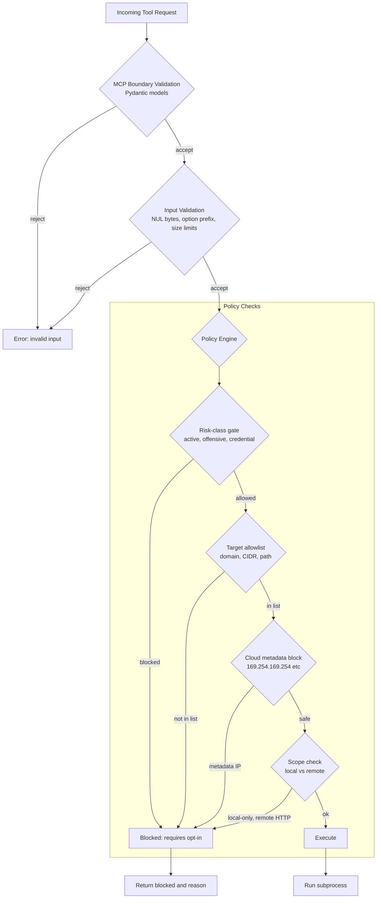
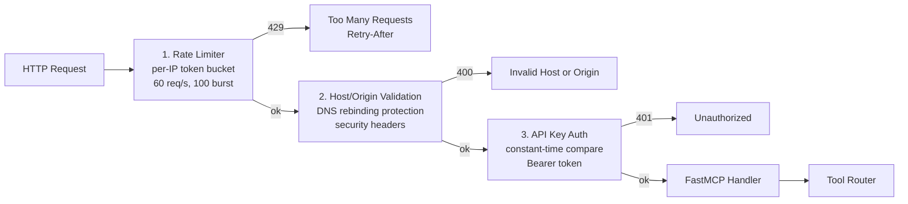

# Architecture

This document explains how ShikariMCP is structured, how requests flow through the system, and how each component contributes to safe, non-blocking security tool execution.

## System Overview


The diagram above shows the full request flow: AI clients connect via stdio or Streamable HTTP, pass through the HTTP middleware stack (rate limiter → Host/Origin validation → API key auth), reach the MCP Tool Router (18 MCP tools), then flow through input validation, the policy engine (risk-class gating, target allowlist, cloud metadata block + DNS TOCTOU re-check), the Tool Runner (manifest → command → execute → parse), and finally to external security binaries. Background jobs are managed by the Run Manager. All events are written to the JSONL audit log. Tool sources span three tiers: 50 manifest-backed tools, 305 `@shikari_tool` wrappers, and 51 agents.

## Project Structure

```
ShikariMCP/
├── src/shikari/
│   ├── server.py                  # Entry point, CLI, MCP tool registration
│   ├── config.py                  # Configuration (env vars + CLI flags)
│   │
│   ├── core/                      # Engine
│   │   ├── registry.py            #   Tool auto-discovery & scope filtering
│   │   ├── executor.py            #   Async subprocess execution + timeout + tree kill
│   │   ├── auth.py                #   API key auth (constant-time compare)
│   │   ├── policy.py              #   Safety controls, target allowlist, metadata block
│   │   ├── tool_runner.py         #   Manifest-driven command builder & executor
│   │   ├── tool_manifest.py       #   Manifest loading and tool entry models
│   │   ├── run_manager.py         #   Background job lifecycle (submit/poll/cancel)
│   │   ├── rate_limiter.py        #   Per-IP token-bucket rate limiter (HTTP)
│   │   ├── http_security.py       #   Host/Origin validation middleware
│   │   ├── artifacts.py           #   Bounded output storage
│   │   ├── audit.py               #   JSONL audit logging
│   │   ├── input_validation.py    #   Pydantic models for MCP boundary validation
│   │   ├── tool_search.py         #   Cross-catalog search with availability status
│   │   ├── dynamic_loader.py      #   On-demand category loading for progressive disclosure
│   │   └── validator.py           #   Input sanitization (legacy wrappers)
│   │
│   ├── manifests/tools/           # Profile manifests (7 profiles, 50 tools)
│   │   ├── core.json              #   12 tools: nmap, subfinder, httpx, nuclei...
│   │   ├── recon.json             #   4 tools: masscan, dnsx, mapcidr, uncover
│   │   ├── web.json               #   7 tools: whatweb, wafw00f, dalfox, arjun...
│   │   ├── cloud.json             #   3 tools: semgrep, gitleaks, checkov
│   │   ├── forensics.json         #   3 tools: yara, volatility3, radare2
│   │   ├── offensive.json         #   3 tools: john, hashcat, hydra
│   │   └── osint.json             #   18 tools: sherlock, shodan, exiftool, greynoise...
│   │
│   ├── parsers/                   # Normalized output parsers (14 parsers)
│   │   ├── models.py              #   Asset, Service, Endpoint, Finding, ParsedOutput
│   │   ├── dispatch.py            #   Parser routing by dotted reference
│   │   ├── nmap.py                #   XML → services, ports, OS
│   │   ├── subfinder.py           #   JSONL → subdomain assets
│   │   ├── httpx.py               #   JSONL → live endpoints, tech detection
│   │   ├── nuclei.py              #   JSONL → vulnerability findings
│   │   ├── ffuf.py                #   JSON → discovered paths
│   │   ├── gobuster.py            #   Text → directories
│   │   ├── nikto.py               #   JSON → web server findings
│   │   ├── sqlmap.py              #   Text → injection findings
│   │   ├── trivy.py               #   JSON → vuln + secret findings
│   │   ├── whois.py               #   Text → registration data
│   │   ├── naabu.py               #   JSONL → port results
│   │   ├── katana.py              #   JSONL → crawled endpoints
│   │   ├── sherlock.py            #   CSV → social media profiles
│   │   ├── exiftool.py            #   JSON → metadata + GPS geolocation
│   │   ├── greynoise.py           #   JSON → IP classification (benign/malicious)
│   │   ├── virustotal.py          #   JSON → scan stats (malicious/suspicious)
│   │   └── theharvester.py        #   Text → emails, hosts, URLs
│   │
│   ├── agents/                    # Workflow agents (51 total)
│   │   ├── _base_agent.py         #   Base class: plan → execute → analyze → report
│   │   ├── _catalog.py            #   Real multi-step CLI plans for all 47 catalog agents
│   │   ├── workflow/              #   13 workflow agents (4 production + 9 experimental)
│   │   ├── intelligence/          #   10 intelligence agents
│   │   ├── infrastructure/        #   8 infrastructure agents
│   │   ├── domain/                #   10 domain-specific agents
│   │   ├── offensive/             #   5 offensive agents (gated)
│   │   └── defensive/             #   5 defensive agents
│   │
│   └── tools/                     # Direct wrappers (305 across 35 categories)
│       ├── _base.py               #   @shikari_tool decorator, ToolMetadata, ToolScope
│       ├── reconnaissance/        #   65 wrappers: amass, subfinder, httpx, shodan...
│       ├── enumeration/           #   30 wrappers: nmap, dirb, gobuster, masscan...
│       ├── osint/                 #   23 wrappers: whois, sherlock, shodan, exiftool...
│       ├── web_application/       #   16 wrappers: whatweb, ffuf, dalfox, sqlmap...
│       ├── exploitation/          #   11 wrappers: searchsploit, nmap NSE...
│       ├── vulnerability_scanning/#   11 wrappers: nmap, masscan, nuclei, nikto...
│       ├── password_attacks/      #   11 wrappers: hashcat, john, hydra, medusa...
│       ├── post_exploitation/     #   8 wrappers: sliver, linpeas, chisel...
│       ├── active_directory/      #   8 wrappers: nxc, bloodhound, certipy, impacket...
│       ├── container_security/    #   7 wrappers: grype, dive, kube-bench, syft...
│       ├── network_attacks/       #   6 wrappers: bettercap, responder, arpspoof...
│       ├── cryptography/          #   6 wrappers: hashid, openssl, ssdeep, hashcat...
│       ├── cloud_security/        #   5 wrappers: trivy, scoutsuite, kube-hunter...
│       ├── code_analysis/         #   5 wrappers: semgrep, bandit, gosec, gitleaks...
│       ├── iot_security/          #   5 wrappers: binwalk, mosquitto, nmap...
│       ├── forensics/             #   4 wrappers: volatility, exiftool, binwalk...
│       ├── reporting/             #   4 wrappers: pandoc, weasyprint, xsltproc...
│       ├── api_security/          #   4 wrappers: arjun, kr, nuclei, ffuf
│       ├── evasion/               #   3 wrappers: msfvenom, unicorn
│       ├── evasion_payloads/      #   2 wrappers: msfvenom, veil
│       ├── mobile/                #   3 wrappers: apktool, jadx, mobsf
│       ├── mobile_security/       #   2 wrappers: objection, apkid
│       ├── payload_generation/    #   2 wrappers: msfvenom
│       ├── database_injection/    #   2 wrappers: bsqlbf, odat
│       ├── ai_ml_security/        #   2 wrappers: garak, modelscan
│       ├── blockchain/            #   3 wrappers: slither, mythril
│       ├── reverse_engineering/   #   3 wrappers: radare2, checksec, qu1cksc0pe
│       ├── wireless/              #   3 wrappers: aircrack-ng, wifite, reaver
│       └── ...                    #   + remaining categories
│
├── tests/                         # 188 pytest unit tests
├── scripts/                       # Installer, verifier, deploy, smoke-test
│   ├── install-tools.sh           #   Profile-based binary installer
│   ├── verify-tools.sh            #   Binary verification
│   ├── install-go-tools.sh        #   Go tool installer
│   ├── install-wordlists.sh       #   SecLists wordlist installer
│   ├── deploy-remote.sh           #   One-command Linux server deployment
│   └── smoke-test.sh              #   26 checks (no binaries needed)
├── docker/                        # Production container
│   ├── Dockerfile                 #   Core profile, non-root, read-only FS
│   └── Dockerfile.core            #   Core-only variant
├── assets/                        # Architecture diagram image
├── docs/                          # Documentation (7 files)
├── compose.yaml                   # Docker Compose config
├── pyproject.toml                 # Python project + dependencies
└── tools.lock.json                # Pinned tool versions (Go + pip)
```

## Core Components

### Tool Discovery

Tools are auto-discovered from `src/shikari/tools/` by scanning for functions decorated with `@shikari_tool`. Each tool declares:

| Property | Values | Purpose |
|----------|--------|---------|
| `scope` | `LOCAL`, `REMOTE`, `BOTH` | Where the tool can run |
| `binary` | e.g. `"nmap"` | Required CLI binary |
| `category` | e.g. `"reconnaissance"` | Capability grouping |
| `capabilities` | e.g. `["active_network"]` | Risk-class gating |
| `quality` | `VERIFIED`, `EXPERIMENTAL`, `GENERATED` | Trust tier |

The registry filters tools based on transport mode and runtime configuration. In single-user, self-hosted mode all tool categories are discovered by default: manifest profiles, all 35 wrapper catalog categories, and the 4 production workflow agents. Use `--disable-legacy-tools` to hide wrappers or `--enable-experimental-tools` to expose the 47 catalog agents.

### Dynamic Category Loading

The dynamic loader (`src/shikari/core/dynamic_loader.py`) enables progressive disclosure — LLMs load only the tool categories they need, keeping the active tool list small. When a category is loaded via `shikari_load_category`, tools are registered with the MCP server and `notifications/tools/list_changed` is emitted automatically.

| Function | Purpose |
|----------|---------|
| `get_categories()` | List all wrapper tool categories with counts |
| `load_category(mcp, category)` | Register tools in a category as MCP tools |
| `unload_category(mcp, category)` | Remove a category's tools |
| `_build_annotations(meta)` | Build ToolAnnotations from tool capabilities |

### Manifest System

Manifests in `src/shikari/manifests/tools/` define manifest-backed tools with:

| Field | Example | Purpose |
|-------|---------|---------|
| `command_templates` | `{"safe": {"argv": ["nmap", "{target}"]}}` | Command with placeholder substitution |
| `output_format` | `"jsonl"`, `"xml"`, `"text"` | Determines parser routing and artifact kind |
| `capabilities` | `["active_network"]` | Risk-class gating |
| `approval` | `"active_tools"`, `"none"` | Required safety gate |
| `parser` | `"shikari.parsers.nmap.parse_xml"` | Dotted reference to output parser |
| `scope` | `"local"`, `"both"` | Transport availability |
| `install` | `{"apt": ["nmap"]}` | Installation hints |

The `tool_runner.py` module builds commands from these templates instead of each wrapper inventing its own command line. This ensures consistent policy enforcement, output handling, and artifact storage.

### Execution Flow



The five stages of manifest-backed execution:

1. **Dry-run** — `dry_run_tool()` builds the command preview without executing. Defaults to `dry_run=true` for safety.
2. **Policy check** — `evaluate_tool_policy()` validates safety gates, target allowlist, and cloud metadata blocking.
3. **TOCTOU re-check** — Immediately before execution, targets are re-resolved to detect DNS rebinding attacks that could bypass the metadata block.
4. **Execution** — `execute_command()` runs the subprocess via `asyncio.create_subprocess_exec` (no shell), with timeout and process-tree termination.
5. **Parsing + Storage** — Raw output is parsed into `ParsedOutput` and stored as artifacts. Only bounded summaries enter the LLM context; full output is read on demand via `shikari_read_artifact`.

### Parser System

Each parser converts tool-specific output into a common `ParsedOutput` model:



| Parser | Tool | Extracts |
|--------|------|---------|
| `nmap.parse_xml` | nmap | Services, ports, OS detection |
| `subfinder.parse_jsonl` | subfinder | Subdomain assets |
| `httpx.parse_jsonl` | httpx | Live endpoints, tech detection |
| `nuclei.parse_jsonl` | nuclei | Vulnerability findings |
| `sherlock.parse_csv` | sherlock | Social media profiles |
| `exiftool.parse_json` | exiftool | Metadata + GPS coordinates |
| `exiftool.parse_gps` | exiftool | Geolocation assets |
| `greynoise.parse_json` | greynoise | IP classification (benign/malicious) |
| `virustotal.parse_json` | vt | Scan stats (malicious/suspicious counts) |
| `theharvester.parse_text` | theHarvester | Emails, hosts, URLs |

Parsers are dispatched by tool ID through `dispatch.py`. Each parser handles malformed/empty input gracefully and never raises.

### Agent System

All agents extend `BaseAgent` and follow a four-phase workflow:



| Agent Tier | Count | Execution | Exposed by default |
|------------|:-----:|-----------|:------------------:|
| Production workflows | 4 | `execute_manifest_plan` (manifest-backed) | Yes |
| Catalog agents | 47 | `execute_command` (raw subprocess) | No (`--enable-experimental-tools`) |

Production workflows run manifest-backed tools with full policy enforcement. Catalog agents execute real multi-step CLI plans defined in `_catalog.py` but use raw subprocess execution — they should be promoted to `execute_manifest_plan` to inherit full policy enforcement.

See [Agents](AGENTS.md) for the full catalog.

### Background Job System



The Run Manager maintains a bounded history of background runs (default 100). Each run has a lifecycle: `queued` → `running` → `success` / `failed` / `cancelled` / `timeout`. Background runs are capped at `default_timeout` (300s) even if the manifest specifies a longer timeout.

## Safety Controls



| Control | What It Prevents |
|---------|------------------|
| MCP boundary validation | Invalid tool IDs, unknown profiles, oversized inputs, path traversal |
| Input validation | NUL bytes, option-prefix injection, target count limits |
| Risk-class gating | Active/offensive/credential tools without explicit opt-in |
| Target allowlist | Scanning unauthorized hosts, domains, CIDRs, or paths |
| Cloud metadata blocking | Access to `169.254.169.254` and equivalent endpoints |
| DNS TOCTOU re-check | DNS rebinding attacks between policy check and execution |
| Scope enforcement | Local-only tools exposed over remote HTTP |
| Dry-run default | Accidental execution without command preview |
| Output bounding | Unbounded memory growth from large tool output |
| Process-tree termination | Zombie processes on timeout or cancellation |
| Background timeout cap | Long-running manifests blocking background slots indefinitely |

## HTTP Security Stack



| Layer | Default | Configurable |
|-------|---------|-------------|
| Rate limiter | 60 req/s, 100 burst per IP | `--rate-limit-rps`, `--rate-limit-burst` (0 to disable) |
| X-Forwarded-For | Ignored (use direct client IP) | `--trust-x-forwarded-for` (only behind trusted proxy) |
| Host validation | localhost, 127.0.0.1, [::1] | `--http-allowed-hosts` |
| Origin validation | localhost origins | `--http-allowed-origins` |
| Auth | Required (Bearer token) | `--api-key`, `--allow-unauthenticated-http` (dev only) |
| Security headers | `nosniff`, `DENY`, `no-referrer` on errors | Automatic |
| Event store | Stateful SSE with replay (3600s TTL) | `--http-stateless`, `--http-json-response` |