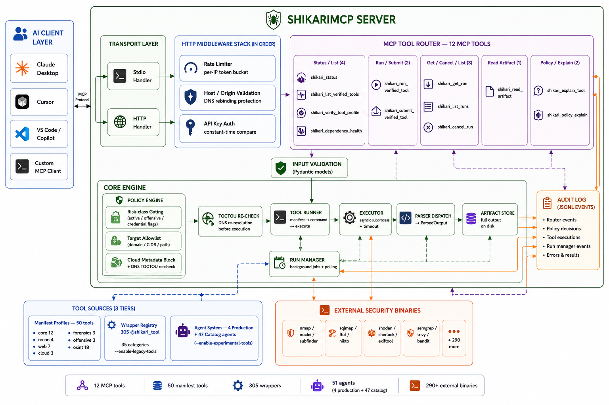
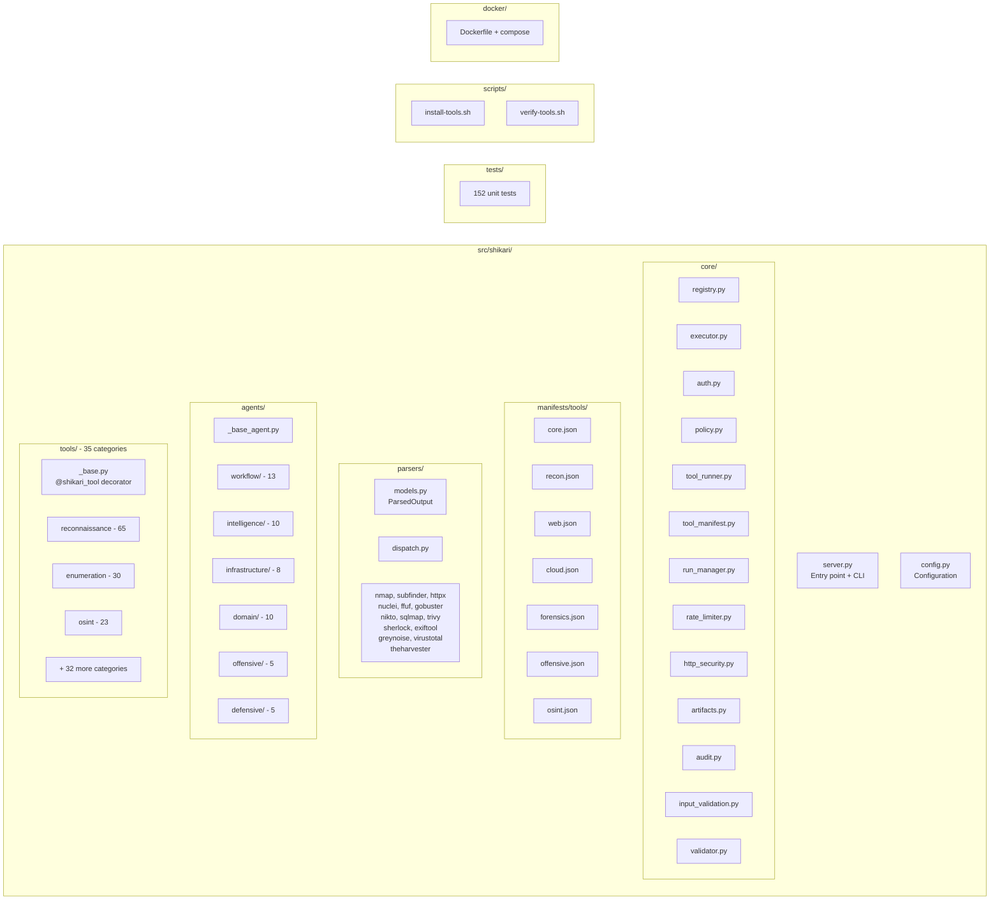
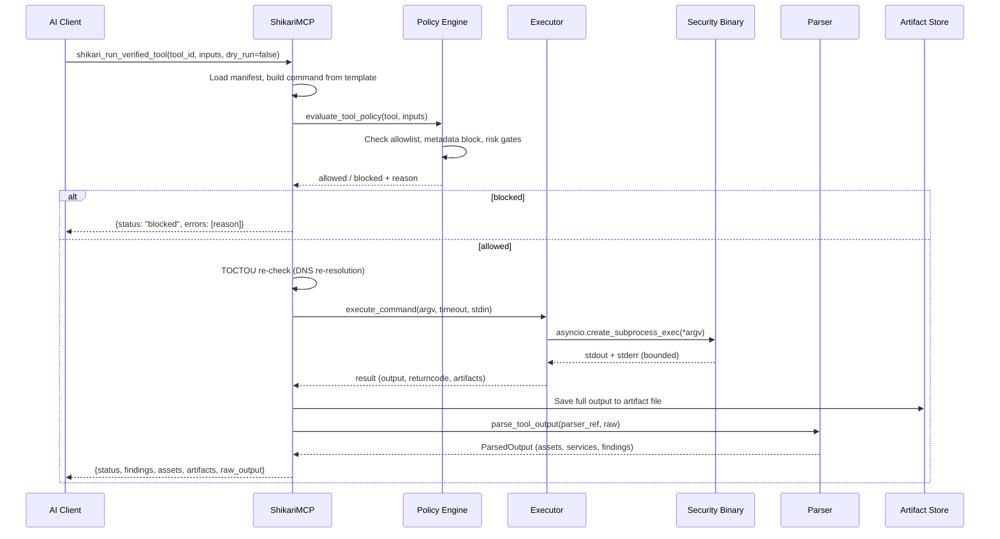
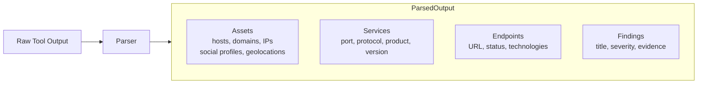
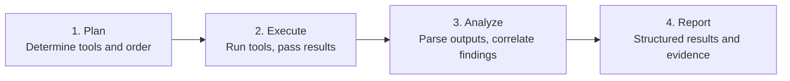
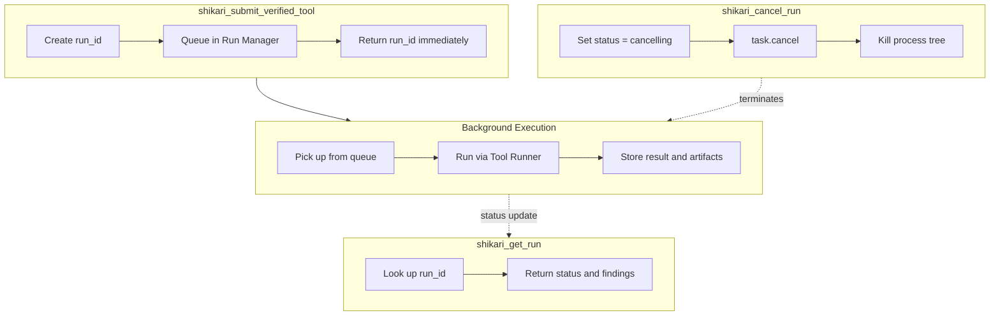
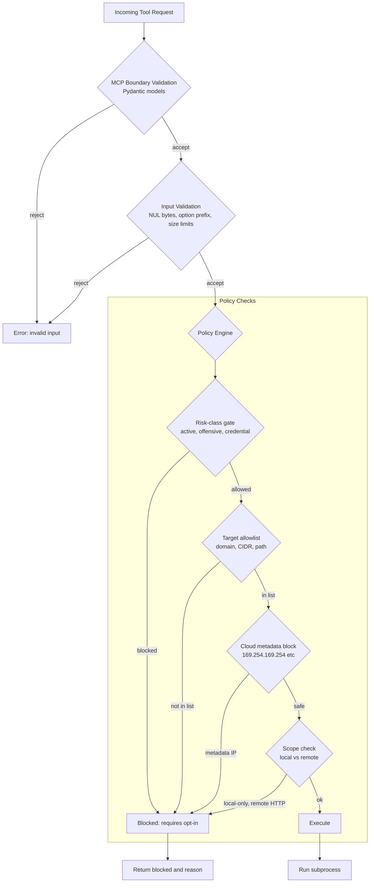
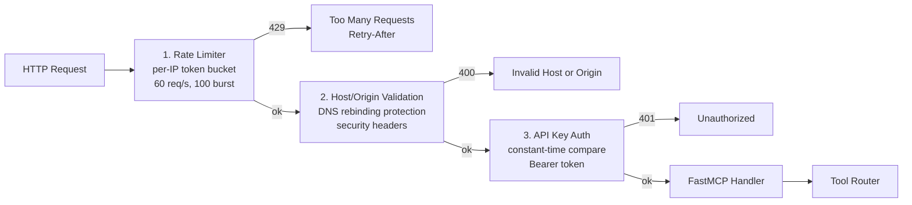

# Architecture

This document explains how ShikariMCP is structured, how requests flow through the system, and how each component contributes to safe, non-blocking security tool execution.

## System Overview

The diagram above shows the full request flow: AI clients connect via stdio or Streamable HTTP, pass through the HTTP middleware stack (rate limiter → Host/Origin validation → API key auth), reach the MCP Tool Router (12 MCP tools), then flow through input validation, the policy engine (risk-class gating, target allowlist, cloud metadata block + DNS TOCTOU re-check), the Tool Runner (manifest → command → execute → parse), and finally to external security binaries. Background jobs are managed by the Run Manager. All events are written to the JSONL audit log. Tool sources span three tiers: 50 manifest-verified tools, 305 `@shikari_tool` wrappers, and 51 agents.

## Project Structure

## Core Components

### Tool Discovery

Tools are auto-discovered from `src/shikari/tools/` by scanning for functions decorated with `@shikari_tool`. Each tool declares:

| Property | Values | Purpose |
|----------|--------|---------|
| `scope` | `LOCAL`, `REMOTE`, `BOTH` | Where the tool can run |
| `binary` | e.g. `"nmap"` | Required CLI binary |
| `category` | e.g. `"reconnaissance"` | Capability grouping |
| `capabilities` | e.g. `["active_network"]` | Risk-class gating |
| `quality` | `VERIFIED`, `EXPERIMENTAL`, `GENERATED` | Trust tier |

The registry filters tools based on transport mode and runtime configuration. By default, only `shikari.agents.workflow` is discovered (4 production workflows). Use `--enable-legacy-tools` or `--enable-experimental-tools` to expose the full catalog.

### Manifest System

Manifests in `src/shikari/manifests/tools/` define verified tools with:

| Field | Example | Purpose |
|-------|---------|---------|
| `command_templates` | `{"safe": {"argv": ["nmap", "{target}"]}}` | Command with placeholder substitution |
| `output_format` | `"jsonl"`, `"xml"`, `"text"` | Determines parser routing and artifact kind |
| `capabilities` | `["active_network"]` | Risk-class gating |
| `approval` | `"active_tools"`, `"none"` | Required safety gate |
| `parser` | `"shikari.parsers.nmap.parse_xml"` | Dotted reference to output parser |
| `scope` | `"local"`, `"both"` | Transport availability |
| `install` | `{"apt": ["nmap"]}` | Installation hints |

The `tool_runner.py` module builds commands from these templates instead of each wrapper inventing its own command line. This ensures consistent policy enforcement, output handling, and artifact storage.

### Execution Flow

The five stages of manifest-backed execution:

1. **Dry-run** — `dry_run_verified_tool()` builds the command preview without executing. Defaults to `dry_run=true` for safety.
2. **Policy check** — `evaluate_tool_policy()` validates safety gates, target allowlist, and cloud metadata blocking.
3. **TOCTOU re-check** — Immediately before execution, targets are re-resolved to detect DNS rebinding attacks that could bypass the metadata block.
4. **Execution** — `execute_command()` runs the subprocess via `asyncio.create_subprocess_exec` (no shell), with timeout and process-tree termination.
5. **Parsing + Storage** — Raw output is parsed into `ParsedOutput` and stored as artifacts. Only bounded summaries enter the LLM context; full output is read on demand via `shikari_read_artifact`.

### Parser System

Each parser converts tool-specific output into a common `ParsedOutput` model:

| Parser | Tool | Extracts |
|--------|------|---------|
| `nmap.parse_xml` | nmap | Services, ports, OS detection |
| `subfinder.parse_jsonl` | subfinder | Subdomain assets |
| `httpx.parse_jsonl` | httpx | Live endpoints, tech detection |
| `nuclei.parse_jsonl` | nuclei | Vulnerability findings |
| `sherlock.parse_csv` | sherlock | Social media profiles |
| `exiftool.parse_json` | exiftool | Metadata + GPS coordinates |
| `exiftool.parse_gps` | exiftool | Geolocation assets |
| `greynoise.parse_json` | greynoise | IP classification (benign/malicious) |
| `virustotal.parse_json` | vt | Scan stats (malicious/suspicious counts) |
| `theharvester.parse_text` | theHarvester | Emails, hosts, URLs |

Parsers are dispatched by tool ID through `dispatch.py`. Each parser handles malformed/empty input gracefully and never raises.

### Agent System

All agents extend `BaseAgent` and follow a four-phase workflow:

| Agent Tier | Count | Execution | Exposed by default |
|------------|:-----:|-----------|:------------------:|
| Production workflows | 4 | `execute_verified_plan` (manifest-backed) | Yes |
| Catalog agents | 47 | `execute_command` (raw subprocess) | No (`--enable-experimental-tools`) |

Production workflows run manifest-backed tools with full policy enforcement. Catalog agents execute real multi-step CLI plans defined in `_catalog.py` but use raw subprocess execution — they should be promoted to `execute_verified_plan` to inherit full policy enforcement.

See [Agents](AGENTS.md) for the full catalog.

### Background Job System

The Run Manager maintains a bounded history of background runs (default 100). Each run has a lifecycle: `queued` → `running` → `success` / `failed` / `cancelled` / `timeout`. Background runs are capped at `default_timeout` (300s) even if the manifest specifies a longer timeout.

## Safety Controls

| Control | What It Prevents |
|---------|------------------|
| MCP boundary validation | Invalid tool IDs, unknown profiles, oversized inputs, path traversal |
| Input validation | NUL bytes, option-prefix injection, target count limits |
| Risk-class gating | Active/offensive/credential tools without explicit opt-in |
| Target allowlist | Scanning unauthorized hosts, domains, CIDRs, or paths |
| Cloud metadata blocking | Access to `169.254.169.254` and equivalent endpoints |
| DNS TOCTOU re-check | DNS rebinding attacks between policy check and execution |
| Scope enforcement | Local-only tools exposed over remote HTTP |
| Dry-run default | Accidental execution without command preview |
| Output bounding | Unbounded memory growth from large tool output |
| Process-tree termination | Zombie processes on timeout or cancellation |
| Background timeout cap | Long-running manifests blocking background slots indefinitely |

## HTTP Security Stack

| Layer | Default | Configurable |
|-------|---------|-------------|
| Rate limiter | 60 req/s, 100 burst per IP | `--rate-limit-rps`, `--rate-limit-burst` (0 to disable) |
| X-Forwarded-For | Ignored (use direct client IP) | `--trust-x-forwarded-for` (only behind trusted proxy) |
| Host validation | localhost, 127.0.0.1, [::1] | `--http-allowed-hosts` |
| Origin validation | localhost origins | `--http-allowed-origins` |
| Auth | Required (Bearer token) | `--api-key`, `--allow-unauthenticated-http` (dev only) |
| Security headers | `nosniff`, `DENY`, `no-referrer` on errors | Automatic |
| Event store | Stateful SSE with replay (3600s TTL) | `--http-stateless`, `--http-json-response` |