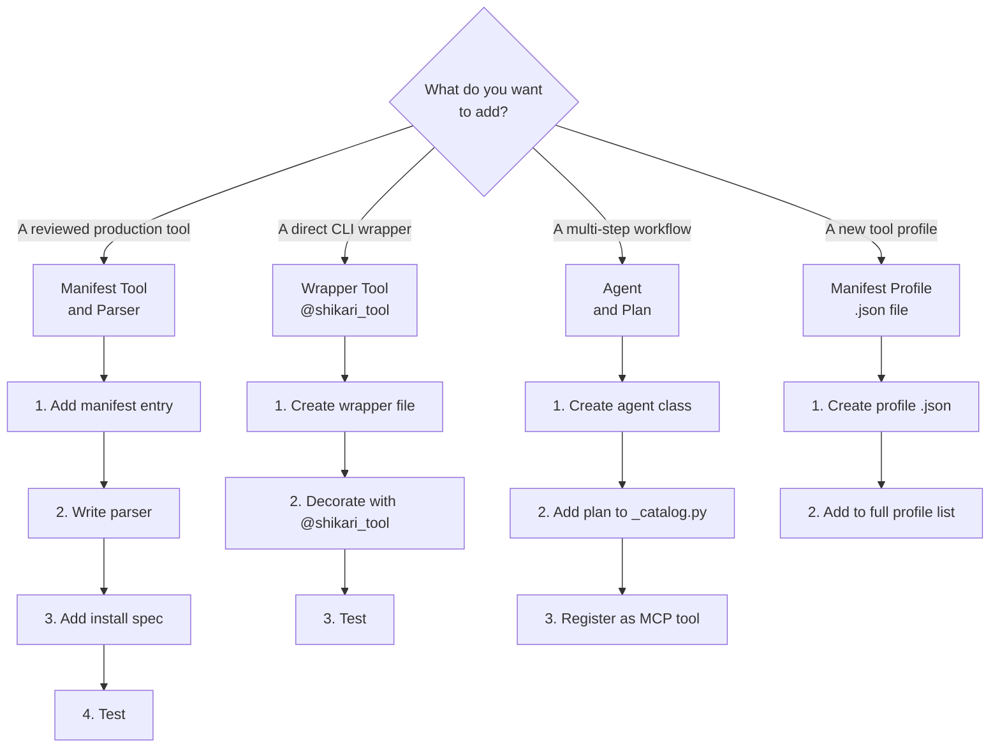

# Contributing to ShikariMCP

This guide explains how to extend ShikariMCP with new security tools, parsers, wrappers, and agents. ShikariMCP has four integration tiers — pick the one that matches your goal.

## Integration Tiers at a Glance



| Tier | Trust Level | Default Exposed | Best For |
|------|-------------|:---------------:|----------|
| Manifest tool + parser | Verified | Yes | Production tools with stable CLI flags |
| Wrapper (`@shikari_tool`) | Verified/Experimental | No (`--enable-legacy-tools`) | Direct CLI access, experimentation |
| Agent | Experimental | No (`--enable-experimental-tools`) | Multi-step workflows |
| Manifest profile | N/A | Via `--tool-profile` | Grouping tools by use case |

---

## 1. Adding a Manifest Tool (Recommended)

Manifest tools are the production path. They get policy enforcement, output parsing, artifact storage, and non-blocking background execution automatically.

### Step 1: Add a manifest entry

Edit the appropriate profile JSON in `src/shikari/manifests/tools/`. For example, to add a tool to the `core` profile:

```json
{
  "id": "mytool_scan",
  "display_name": "MyTool Scanner",
  "binary": "mytool",
  "category": "vulnerability_scanning",
  "quality": "verified",
  "scope": "both",
  "capabilities": ["active_network"],
  "approval": "active_tools",
  "target_types": ["host", "ip"],
  "version_command": ["mytool", "--version"],
  "install": {"apt": ["mytool"]},
  "command_templates": {
    "safe": {
      "argv": ["mytool", "-json", "{target}"],
      "timeout": 300,
      "output_format": "jsonl"
    }
  },
  "parser": "shikari.parsers.mytool.parse_jsonl"
}
```

| Field | Required | Description |
|-------|:--------:|-------------|
| `id` | Yes | Unique tool identifier (used by AI clients) |
| `display_name` | Yes | Human-readable name |
| `binary` | Yes | CLI binary name (must be on PATH) |
| `category` | Yes | One of the 35 categories (see [TOOLS.md](TOOLS.md)) |
| `quality` | No | `verified` (default), `experimental`, or `generated` |
| `scope` | No | `local`, `both` (default). `local` = stdio + local HTTP only |
| `capabilities` | No | Risk classes: `active_network`, `vulnerability_scan`, `exploitation`, `credential_attack`, `payload_generation`, `mitm`, `wireless`, `local_forensics`, `cloud_mutation`, `passive_recon`, `local_analysis`, `osint`, `cloud_audit` |
| `approval` | No | `none` (default), `active_tools`, `offensive_tools`, `credential_tools` |
| `target_types` | No | `host`, `ip`, `cidr`, `domain`, `url`, `email`, `username`, `file`, `query`, `hash`, `stdin_list` |
| `version_command` | Yes | Command to check the binary is installed |
| `install` | No | Installation hints: `apt`, `go`, `pipx`, `official` |
| `command_templates` | Yes | Named templates (usually `safe`) with `argv`, `timeout`, `output_format`, optional `stdin` |
| `parser` | No | Dotted reference to parser function, or `null` |

### Placeholder syntax

Use `{placeholder}` in `argv` and `stdin`. The runner substitutes these from the `inputs` dict:

```json
"argv": ["nmap", "-oX", "-", "-sV", "{target}"]
```

Common input aliases are auto-mapped: if the AI passes `target`, it fills `target`, `url`, `host`, `path`, `query`, `file`, `targets` placeholders automatically.

The `output_file` placeholder is auto-allocated to an artifact path — use it when the tool writes to a file:

```json
"argv": ["ffuf", "-u", "{url}/FUZZ", "-w", "{wordlist}", "-o", "{output_file}", "-of", "json"]
```

### Step 2: Write a parser (optional but recommended)

Create `src/shikari/parsers/mytool.py`:

```python
from __future__ import annotations
from shikari.parsers.common import iter_json_lines
from shikari.parsers.models import Asset, Finding, ParsedOutput


def parse_jsonl(raw: str) -> ParsedOutput:
    """Parse mytool JSONL output into structured findings."""
    parsed = ParsedOutput()
    for item in iter_json_lines(raw):
        host = item.get("host") or item.get("ip")
        if host:
            parsed.assets.append(
                Asset(value=str(host), type="host", source="mytool", metadata=item)
            )
        if item.get("vulnerability"):
            parsed.findings.append(
                Finding(
                    title=item["vulnerability"],
                    severity=item.get("severity", "info"),
                    target=str(host or ""),
                    description=item.get("description", ""),
                )
            )
    return parsed
```

| Model | Field | Use For |
|-------|-------|---------|
| `Asset` | `value`, `type`, `source`, `metadata` | Discovered hosts, domains, IPs, social profiles, geolocations |
| `Service` | `host`, `port`, `protocol`, `name`, `product`, `version` | Open ports and services |
| `Endpoint` | `url`, `status_code`, `title`, `technologies` | Web endpoints |
| `Finding` | `title`, `severity`, `target`, `description`, `evidence` | Vulnerabilities, misconfigurations |
| `Evidence` | `source`, `value`, `metadata` | Supporting evidence for findings |

**Rules:**
- Handle malformed/empty input gracefully — never raise.
- Return an empty `ParsedOutput()` on error.
- Use `iter_json_lines` from `shikari.parsers.common` for JSONL output.

### Step 3: Add to the `full` profile

If you created a new profile JSON, add it to the `full` aggregation list in `src/shikari/core/tool_manifest.py`:

```python
for name in ("core", "recon", "web", "cloud", "forensics", "offensive", "osint")
# Add your profile name here
```

### Step 4: Test

```bash
# Verify the manifest loads
uv run shikari-mcp tools verify --profile <profile> --json

# Dry-run the command
uv run shikari-mcp tools dry-run mytool_scan --input target=example.com

# Run the tool
uv run shikari-mcp tools run mytool_scan --input target=example.com --enable-active-tools

# Run tests
uv run pytest tests -q
uv run ruff check src tests
```

---

## 2. Adding a Wrapper Tool

Wrappers are direct `@shikari_tool` functions for the compatibility catalog. They're hidden by default and exposed via `--enable-legacy-tools`.

### Create a wrapper file

Create a file in the appropriate category directory, e.g. `src/shikari/tools/reconnaissance/mytool.py`:

```python
from shikari.tools._base import shikari_tool, ToolScope
from shikari.core.executor import execute_command
from shikari.core.validator import validate_target


@shikari_tool(
    name="mytool_scan",
    category="reconnaissance",
    scope=ToolScope.BOTH,
    binary="mytool",
    description="My custom reconnaissance tool",
)
async def mytool_scan(target: str, verbose: bool = False) -> str:
    """
    Run mytool against a target.

    Args:
        target: Target domain or IP
        verbose: Enable verbose output
    """
    target = validate_target(target)
    cmd = ["mytool", target]
    if verbose:
        cmd.append("-v")

    result = await execute_command(cmd, timeout=120)
    return result.output if result.success else f"Mytool error: {result.stderr}"
```

### Wrapper rules

| Rule | Why |
|------|-----|
| Always build `cmd` as a list, never a string | Prevents shell injection (`create_subprocess_exec` with no shell) |
| Call `validate_target()` for host/IP/domain params | Enforces input sanitization |
| Don't call `validate_target()` for file paths or usernames | It's for host targets only |
| Use `ToolScope.LOCAL` for file-only tools | Blocks them in remote HTTP mode |
| Use `ToolScope.BOTH` for network/API tools | Works in stdio and HTTP |
| Check existing names to avoid collisions | The registry auto-aliases duplicates with a warning |

### Capability gating

The `category` you choose determines which `--enable-*` flags are needed:

| Category | Capabilities | Required Flag |
|----------|---------------|---------------|
| `reconnaissance` | `recon` | None (passive) |
| `enumeration` | `active_network` | `--enable-active-tools` |
| `vulnerability_scanning` | `vulnerability_scan`, `active_network` | `--enable-active-tools` |
| `exploitation` | `exploitation` | `--enable-offensive-tools` |
| `password_attacks` | `credential_attack` | `--enable-credential-tools` |
| `network_attacks` | `mitm`, `active_network` | `--enable-offensive-tools` |
| `wireless` | `wireless` | `--enable-offensive-tools` |
| `osint` | `osint` | None (passive) |

---

## 3. Adding an Agent

Agents are multi-step workflows that orchestrate multiple tools.

### Step 1: Create an agent class

Create a file in the appropriate agent directory, e.g. `src/shikari/agents/domain/myagent_agent.py`:

```python
from typing import Any
from fastmcp import Context
from shikari.agents._base_agent import BaseAgent
from shikari.agents._catalog import build_default_plan
from shikari.tools._base import shikari_tool, ToolScope
from shikari.core.executor import execute_command


class MyAgent(BaseAgent):
    """My custom security workflow."""
    name = "MyAgent"
    description = "Custom security assessment workflow."
    audience = ["red", "blue"]

    async def plan(self, target: str, **kwargs: Any) -> list[dict[str, Any]]:
        return build_default_plan(self.name, target)

    async def execute(
        self,
        plan: list[dict[str, Any]],
        ctx: Context | None = None,
        **kwargs: Any,
    ) -> dict[str, Any]:
        results = {}
        for i, step in enumerate(plan):
            if ctx:
                await ctx.report_progress(i, len(plan))
                await ctx.info(f"[{self.name}] Running {step['tool']}...")
            res = await execute_command(step["cmd"], timeout=300)
            results[step["name"]] = res.output
        return results

    async def analyze(self, results: dict[str, Any]) -> list[dict[str, Any]]:
        return [{"severity": "INFO", "title": "Assessment complete", "detail": str(results)}]


@shikari_tool(
    name="agent_domain_myagent",
    category="agent_domain",
    scope=ToolScope.LOCAL,
    description="Invoke the MyAgent workflow.",
)
async def agent_domain_myagent(target: str, ctx: Context) -> str:
    """Run the MyAgent."""
    agent = MyAgent()
    res = await agent.run(ctx=ctx, target=target)
    return res.to_report()
```

### Step 2: Add a plan to `_catalog.py`

Add a plan function and register it in the `_PLANS` dict in `src/shikari/agents/_catalog.py`:

```python
def _myagent_plan(target: str) -> list[dict[str, Any]]:
    return [
        _step("service_scan", "nmap", ["nmap", "-sV", "--top-ports", "100", target]),
        _step("template_scan", "nuclei", [
            "nuclei", "-u", target, "-severity", "medium,high,critical",
            "-jsonl", "-silent", "-no-color",
        ]),
    ]

# Add to _PLANS dict:
"myagent": _myagent_plan,
```

### Agent categories

| Category | Flag Required | Tool Name Prefix |
|----------|---------------|------------------|
| `agent_workflow` | `--enable-experimental-tools` (except 4 production) | `workflow_*` |
| `agent_domain` | `--enable-experimental-tools` | `agent_domain_*` |
| `agent_intelligence` | `--enable-experimental-tools` | `agent_intelligence_*` |
| `agent_infrastructure` | `--enable-experimental-tools` | `agent_infrastructure_*` |
| `agent_offensive` | `--enable-offensive-tools` + `--enable-experimental-tools` | `agent_offensive_*` |
| `agent_defensive` | `--enable-experimental-tools` | `agent_defensive_*` |

---

## 4. Creating a New Manifest Profile

### Step 1: Create the profile JSON

Create `src/shikari/manifests/tools/myprofile.json`:

```json
{
  "schema_version": 1,
  "profile": "myprofile",
  "description": "My custom tool profile.",
  "tools": [
    {
      "id": "mytool_scan",
      "display_name": "MyTool",
      "binary": "mytool",
      "category": "reconnaissance",
      "quality": "verified",
      "scope": "both",
      "capabilities": ["passive_recon"],
      "approval": "none",
      "target_types": ["domain"],
      "version_command": ["mytool", "--version"],
      "install": {"pipx": "mytool"},
      "command_templates": {
        "safe": {"argv": ["mytool", "{target}"], "timeout": 120, "output_format": "text"}
      },
      "parser": null
    }
  ]
}
```

### Step 2: Add to the `full` profile

In `src/shikari/core/tool_manifest.py`, add your profile name to the `full` aggregation list.

### Step 3: Use it

```bash
uv run shikari-mcp --transport stdio --tool-profile myprofile
uv run shikari-mcp tools verify --profile myprofile --json
```

---

## Development Setup

```bash
git clone https://github.com/Zaeem20/ShikariMCP.git
cd ShikariMCP
uv sync --group dev
```

### Running tests

```bash
uv run pytest tests -q                    # Unit tests (188)
uv run ruff check src tests               # Lint
uv run shikari-mcp tools verify --profile core --json  # Binary verification
```

### Code style

- Python 3.11+ (use `from __future__ import annotations`)
- Ruff for linting (run `uv run ruff check --fix` to auto-fix)
- No new dependencies without discussion — keep the dependency surface minimal
- Every parser must handle malformed input gracefully (never raise)
- Every wrapper must use list-based command execution (never `shell=True`)

### Project structure

| Directory | Purpose |
|-----------|---------|
| `src/shikari/server.py` | Entry point, CLI, MCP tool registration |
| `src/shikari/config.py` | Configuration (env vars + CLI flags) |
| `src/shikari/core/` | Engine: executor, policy, runner, registry, auth, rate limiter |
| `src/shikari/manifests/tools/` | Profile manifests (JSON) |
| `src/shikari/parsers/` | Output parsers (one per tool) |
| `src/shikari/agents/` | Workflow agents (6 categories) |
| `src/shikari/tools/` | Direct wrappers (35 categories) |
| `tests/` | Pytest suite |
| `scripts/` | Install and verify scripts |
| `docker/` | Production container |

## Pull Request Checklist

- [ ] Tests pass: `uv run pytest tests -q`
- [ ] Lint passes: `uv run ruff check src tests`
- [ ] Manifest loads: `uv run shikari-mcp tools verify --profile <profile> --json`
- [ ] No new dependencies added without justification
- [ ] Parsers handle empty/malformed input gracefully
- [ ] Wrappers use list-based command execution
- [ ] Tool names don't collide with existing registry entries
- [ ] Documentation updated if adding tools or profiles