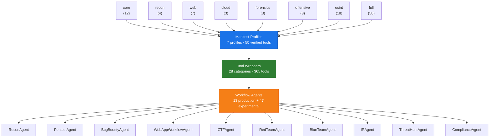

# Tools & Profiles

ShikariMCP is a tool orchestration platform for security operations. It manages 305 tools across 28 categories in its wrapper registry, surfaces 50 verified tools through 7 manifest profiles, and executes them through intelligent workflow agents.

---

## Tool Catalog Model

ShikariMCP organizes tools in three tiers. Manifest profiles are the production-ready entry point; wrappers provide compatibility and breadth; agents deliver automated, multi-step workflows.



| Tier | Default | Description |
|------|---------|-------------|
| **Manifest profiles** | Enabled by default | 7 curated profiles containing 50 verified, reviewed tools with command templates, output parsers, and safety policies. |
| **Wrapper catalog** | Hidden (`--enable-legacy-tools`) | 305 wrappers across 28 categories, each backed by a real CLI binary. Useful for migration and experimentation. |
| **Workflow agents** | 13 default, 47 gated | Multi-step plans that chain tools together. Production agents use manifest tools via `execute_verified_plan`; catalog agents use `execute_command` with policy checks. |

Every tool in the system is invoked through `shikari_run_verified_tool` or `shikari_submit_verified_tool` — individual MCP schema entries are not created per tool.

---

## Manifest Profiles

Seven profiles are defined in `src/shikari/manifests/tools/`. Each profile is a JSON manifest containing tool IDs, command templates, output parsers, safety gates, and install instructions. The `full` profile aggregates all others for a total of 50 tools.

| Profile | Tools | Focus |
|---------|-------|-------|
| `core` | 12 | Default local-first recon, probing, web scanning, container and code analysis |
| `recon` | 4 | Expanded asset discovery and target normalization |
| `web` | 7 | Web application testing extras — fingerprinting, TLS, parameter discovery |
| `cloud` | 3 | Code analysis, secrets detection, IaC and cloud security scanning |
| `forensics` | 3 | Local file analysis, memory forensics, and reverse engineering |
| `offensive` | 3 | Explicit opt-in offline credential testing and password attacks |
| `osint` | 18 | Social media intelligence, geolocation, threat intel, and data breach lookups |
| `full` | 50 | Combined arsenal — aggregates every tool from all profiles above |

---

### Core Profile (12 tools)

Default local-first verified tools for reconnaissance, web probing, vulnerability scanning, container and code analysis.

| Tool | ID | Category | Purpose | Output | Install |
|------|----|----------|---------|--------|---------|
| **Nmap** | `nmap_scan` | Reconnaissance | Service/version discovery, port scanning across hosts and CIDR ranges | XML | `apt: nmap` |
| **Subfinder** | `subfinder_enum` | Reconnaissance | Passive subdomain enumeration from public sources | JSONL | `go install` |
| **httpx** | `httpx_probe` | Reconnaissance | HTTP probing — status codes, titles, technology detection | JSONL | `go install` |
| **Nuclei** | `nuclei_scan` | Vulnerability scanning | Template-based vulnerability detection across thousands of checks | JSONL | `go install` |
| **Naabu** | `naabu_scan` | Reconnaissance | Fast port discovery with SYN and connect scans | JSONL | `go install` + `libpcap` |
| **Katana** | `katana_crawl` | Web application | Web crawling and endpoint discovery | JSONL | `go install` |
| **ffuf** | `ffuf_fuzz` | Web application | Directory and content fuzzing with customizable wordlists | JSON/JSONL | `go install` |
| **Gobuster** | `gobuster_dir` | Web application | Directory and file brute forcing | Text | `go install` |
| **Nikto** | `nikto_scan` | Web application | Web server misconfiguration and vulnerability checks | JSON | GitHub release |
| **SQLMap** | `sqlmap_scan` | Web application | Conservative SQL injection detection and exploitation | Text | `apt: sqlmap` |
| **Trivy** | `trivy_scan` | Cloud security | Filesystem, container image, and dependency vulnerability scanning | JSON | Official installer |
| **Whois** | `whois_lookup` | Reconnaissance | Domain and IP registration context lookup | Text | `apt: whois` |

---

### Recon Profile (4 tools)

Expanded reconnaissance utilities for internet-exposure discovery, DNS resolution, and target normalization.

| Tool | ID | Category | Purpose | Output | Install |
|------|----|----------|---------|--------|---------|
| **Masscan** | `masscan_scan` | Reconnaissance | High-speed port scanning across large IP ranges | Text | `apt: masscan` |
| **dnsx** | `dnsx_query` | Reconnaissance | Fast DNS resolver for A, AAAA, CNAME, and other record types | JSONL | `go install` |
| **mapcidr** | `mapcidr_expand` | Reconnaissance | CIDR expansion and IP address aggregation | Text | `go install` |
| **Uncover** | `uncover_search` | Reconnaissance | Search engine for exposed services on the internet | JSONL | `go install` |

---

### Web Profile (7 tools)

Web application testing tools for fingerprinting, TLS assessment, parameter discovery, and XSS scanning.

| Tool | ID | Category | Purpose | Output | Install |
|------|----|----------|---------|--------|---------|
| **WhatWeb** | `whatweb_scan` | Web application | Website fingerprinting and technology detection | JSON | `apt: whatweb` |
| **wafw00f** | `wafw00f_scan` | Web application | Web application firewall detection and fingerprinting | JSON | `apt: wafw00f` |
| **testssl.sh** | `testssl_scan` | Web application | TLS/SSL protocol and cipher suite testing | JSON | `apt: testssl.sh` |
| **Dalfox** | `dalfox_scan` | Web application | Parameter-based XSS vulnerability scanner | JSON | `go install` |
| **Arjun** | `arjun_scan` | Web application | HTTP parameter discovery for API and web endpoints | JSON | `pipx: arjun` |
| **SSLScan** | `sslscan_scan` | Web application | Fast TLS/SSL service enumeration and cipher check | XML | `apt: sslscan` |
| **tlsx** | `tlsx_scan` | Web application | TLS certificate and cipher information gathering | JSONL | `go install` |

---

### Cloud Profile (3 tools)

Code analysis, secrets detection, and IaC security scanning for DevSecOps workflows.

| Tool | ID | Category | Purpose | Output | Install |
|------|----|----------|---------|--------|---------|
| **Semgrep** | `semgrep_scan` | Code analysis | Static analysis with custom and community rules | JSON | `pipx: semgrep` |
| **Gitleaks** | `gitleaks_scan` | Code analysis | Git repository secrets and credential scanning | JSON | `go install` |
| **Checkov** | `checkov_scan` | Cloud security | Infrastructure-as-Code security and compliance scanning | JSON | `pipx: checkov` |

---

### Forensics Profile (3 tools)

Local file analysis, memory forensics, and binary reverse engineering.

| Tool | ID | Category | Purpose | Output | Install |
|------|----|----------|---------|--------|---------|
| **YARA** | `yara_scan` | Forensics | Pattern-matching for malware identification and classification | Text | `apt: yara` |
| **Volatility3** | `volatility3_scan` | Forensics | Memory forensics and RAM dump analysis | Text | `pipx: volatility3` |
| **Radare2** | `radare2_info` | Reverse engineering | Binary analysis, disassembly, and reverse engineering | JSON | `apt: radare2` |

---

### Offensive Profile (3 tools)

Explicit opt-in credential testing tools. Gated behind `--enable-offensive-tools` and `--enable-credential-tools`.

| Tool | ID | Category | Purpose | Output | Install |
|------|----|----------|---------|--------|---------|
| **John the Ripper** | `john_crack` | Password attacks | Offline hash cracking with multiple hash formats | Text | `apt: john` |
| **Hashcat** | `hashcat_crack` | Password attacks | GPU-accelerated offline hash cracking | Text | `apt: hashcat` |
| **Hydra** | `hydra_login_check` | Password attacks | Online network service login brute forcing | Text | `apt: hydra` |

---

### OSINT Profile (18 tools)

The OSINT profile collects tools for passive intelligence gathering that query external APIs and public sources without sending traffic to the target's own network. All tools work in both stdio and remote HTTP modes unless marked as local-only.

#### Sub-Category Breakdown

The 18 tools in the OSINT profile are organized into five functional groups:

| Sub-Category | Tool | Binary | Scope | API Key Required |
|-------------|------|--------|-------|-----------------|
| **SOCINT** | Sherlock | `sherlock` | both | No |
| (Social Media Intelligence) | Maigret | `maigret` | both | No |
| | Holehe | `holehe` | both | No |
| | Socialscan | `socialscan` | both | No |
| **Geo-OSINT** | Exiftool — Full Metadata | `exiftool` | local | No |
| (Geolocation & Metadata) | Exiftool — GPS Extraction | `exiftool` | local | No |
| **Threat Intelligence** | Shodan — Host Lookup | `shodan` | both | Yes |
| (Attack Surface & Intel) | Shodan — Search | `shodan` | both | Yes |
| | Censys — Host View | `censys` | both | Yes |
| | Censys — Search | `censys` | both | Yes |
| | GreyNoise — IP Intelligence | `greynoise` | both | Yes |
| | GreyNoise — Quick Check | `greynoise` | both | Yes |
| **Data Breach** | VirusTotal — File Hash | `vt` | both | Yes |
| (Compromise & Leak Intel) | VirusTotal — URL Lookup | `vt` | both | Yes |
| | VirusTotal — IP Lookup | `vt` | both | Yes |
| | VirusTotal — Domain Lookup | `vt` | both | Yes |
| | h8mail — Breach Lookup | `h8mail` | both | Optional |
| **Domain Intelligence** | theHarvester | `theHarvester` | both | Varies by source |

#### Tool Details

| Tool | ID | Category | Purpose | Output | Install |
|------|----|----------|---------|--------|---------|
| **Sherlock** | `sherlock_username` | OSINT | Search for a username across hundreds of social networks | CSV | `pipx: sherlock-project` |
| **Maigret** | `maigret_username` | OSINT | Search for a username across popular websites with deeper coverage | Text | `pipx: maigret` |
| **Holehe** | `holehe_email` | OSINT | Check if an email is registered on various online platforms | Text | `pipx: holehe` |
| **Socialscan** | `socialscan_check` | OSINT | Check email address and username availability on online platforms | Text | `pipx: socialscan` |
| **Exiftool (metadata)** | `exiftool_metadata` | OSINT | Extract all metadata tags (EXIF, XMP, IPTC) from files | JSON | `apt: libimage-exiftool-perl` |
| **Exiftool (GPS)** | `exiftool_gps` | OSINT | Extract GPS coordinates and geolocation data from media files | JSON | `apt: libimage-exiftool-perl` |
| **Shodan (host)** | `shodan_host` | OSINT | Look up an IP address for open ports, services, and banners | Text | `pipx: shodan` |
| **Shodan (search)** | `shodan_search` | OSINT | Search Shodan's device and service index by query | Text | `pipx: shodan` |
| **Censys (host)** | `censys_host` | OSINT | View detailed host information from Censys's internet scan data | Text | `pipx: censys` |
| **Censys (search)** | `censys_search` | OSINT | Search Censys hosts index with structured queries | Text | `pipx: censys` |
| **VirusTotal (file)** | `vt_file_lookup` | OSINT | Scan a file hash (MD5, SHA-1, SHA-256) against VirusTotal | JSON | VT CLI release |
| **VirusTotal (URL)** | `vt_url_lookup` | OSINT | Scan a URL against VirusTotal's threat database | JSON | VT CLI release |
| **VirusTotal (IP)** | `vt_ip_lookup` | OSINT | Look up an IP address in VirusTotal's correlation data | JSON | VT CLI release |
| **VirusTotal (domain)** | `vt_domain_lookup` | OSINT | Look up a domain in VirusTotal's passive DNS and relationships | JSON | VT CLI release |
| **GreyNoise (IP)** | `greynoise_ip` | OSINT | Full IP intelligence — noise classification, tags, and metadata | JSON | `pipx: greynoise` |
| **GreyNoise (quick)** | `greynoise_quick` | OSINT | Quick IP check — returns whether an IP is noise or benign | JSON | `pipx: greynoise` |
| **h8mail** | `h8mail_breach` | OSINT | Look up an email address against known data breaches | Text | `pipx: h8mail` |
| **theHarvester** | `theharvester_domain` | OSINT | Domain enumeration — emails, subdomains, IPs, and URLs from public sources | Text | GitHub release |

---

## Wrapper Catalog

Beyond the manifest-backed verified tools, the wrapper catalog under `src/shikari/tools/` provides direct `@shikari_tool` wrappers across 28 categories. These wrappers are hidden by default and exposed via `--enable-legacy-tools`. Every category contains real wrappers backed by real CLI binaries.

Wrappers are gated by capability: active, offensive, credential, MITM, and wireless tools require the corresponding `--enable-*` opt-in. Use `shikari_status` to inspect which gates are open and `shikari_dependency_health` to see which binaries are installed.

| Category | Wrappers | Notable Binaries |
|----------|----------|------------------|
| `active_directory` | 8 | nxc, bloodhound-python, certipy, impacket, ldapsearch, enum4linux-ng, kerbrute |
| `ai_ml_security` | 2 | garak, modelscan |
| `api_security` | 4 | arjun, kr, nuclei, ffuf |
| `blockchain` | 3 | slither, mythril |
| `cloud_security` | 5 | trivy, scoutsuite, kube-hunter, pacu, aws |
| `code_analysis` | 5 | semgrep, bandit, gosec, trufflehog, gitleaks |
| `container_security` | 7 | grype, dive, kube-bench, kube-hunter, syft, checkov |
| `cryptography` | 6 | hashid, openssl, ssdeep, ssh-keygen, hashcat |
| `database_injection` | 2 | bsqlbf, odat |
| `enumeration` | 30 | nmap, dirb, gobuster, masscan, dnsrecon |
| `evasion` | 3 | msfvenom, unicorn |
| `evasion_payloads` | 2 | msfvenom, veil |
| `exploitation` | 11 | searchsploit, nmap NSE, metasploit |
| `forensics` | 4 | volatility, exiftool, steghide, binwalk |
| `iot_security` | 5 | binwalk, mosquitto_sub/pub, nmap |
| `mobile` | 3 | apktool, jadx, mobsf |
| `mobile_security` | 2 | objection, apkid |
| `network_attacks` | 6 | bettercap, responder, arpspoof, ettercap |
| `osint` | 23 | whois, dig, nslookup, theHarvester, shodan, dnsx, sherlock, maigret, holehe, socialscan, exiftool, censys, vt, greynoise, h8mail |
| `password_attacks` | 11 | hashcat, john, hydra, medusa, cewl, crunch |
| `payload_generation` | 2 | msfvenom |
| `post_exploitation` | 8 | sliver, linpeas, chisel, c2 frameworks |
| `reconnaissance` | 65 | amass, subfinder, httpx, shodan, theHarvester, dnsx |
| `reporting` | 4 | pandoc, weasyprint, wkhtmltopdf, xsltproc |
| `reverse_engineering` | 3 | radare2, checksec, qu1cksc0pe |
| `vulnerability_scanning` | 11 | nmap, masscan, nuclei, nikto |
| `web_application` | 16 | whatweb, wafw00f, ffuf, dalfox, testssl.sh, sslscan, tlsx, wpscan, sqlmap |
| `wireless` | 3 | aircrack-ng, wifite, reaver |

**Total: 305 wrappers across 28 categories.**

> **Note on OSINT category (23 wrappers):** The wrapper catalog's `osint` category is distinct from the OSINT manifest profile. The catalog contains a broader set of community-contributed wrappers including `whois`, `dig`, `nslookup`, and additional variants. The manifest profile (18 tools) is the curated, reviewed subset with production parsers and command templates.

---

## Install and Verify

### Debian / Ubuntu / Kali

```bash
# Install the core profile (12 tools)
./scripts/install-tools.sh --profile core

# Install the full arsenal (50 tools)
./scripts/install-tools.sh --profile full

# Verify installed binaries with JSON output
./scripts/verify-tools.sh --profile core --json

# Or use the Python CLI directly
shikari-mcp tools verify --profile full --json
```

### OS-Specific Package Installation

| Tool | Debian/Ubuntu/Kali | macOS (Homebrew) | Go Install |
|------|--------------------|------------------|------------|
| Nmap | `apt: nmap` | `brew: nmap` | — |
| Subfinder | — | `brew: subfinder` | `go install` |
| httpx | — | — | `go install` |
| Nuclei | — | `brew: nuclei` | `go install` |
| Naabu | `apt: libpcap-dev` | — | `go install` |
| Masscan | `apt: masscan` | `brew: masscan` | — |
| Sherlock | `pipx: sherlock-project` | `pipx: sherlock-project` | — |
| theHarvester | — | — | GitHub release |
| Trivy | `apt: trivy` | `brew: trivy` | — |

### Python / pipx Tools

```bash
# OSINT tools (pipx isolates each tool in its own environment)
pipx install sherlock-project
pipx install maigret
pipx install holehe
pipx install socialscan
pipx install shodan
pipx install censys
pipx install greynoise
pipx install h8mail

# Cloud / code analysis tools
pipx install semgrep
pipx install checkov
pipx install arjun
```

### Go Tools

```bash
# ProjectDiscovery suite
go install github.com/projectdiscovery/subfinder/v2/cmd/subfinder@latest
go install github.com/projectdiscovery/httpx/cmd/httpx@latest
go install github.com/projectdiscovery/nuclei/v3/cmd/nuclei@latest
go install github.com/projectdiscovery/naabu/v2/cmd/naabu@latest
go install github.com/projectdiscovery/katana/cmd/katana@latest
go install github.com/projectdiscovery/dnsx/cmd/dnsx@latest
go install github.com/projectdiscovery/mapcidr/cmd/mapcidr@latest
go install github.com/projectdiscovery/uncover/cmd/uncover@latest
go install github.com/projectdiscovery/tlsx/cmd/tlsx@latest

# Web and fuzzing tools
go install github.com/ffuf/ffuf/v2@latest
go install github.com/OJ/gobuster/v3@latest
go install github.com/hahwul/dalfox/v2@latest

# Secrets and code analysis
go install github.com/zricethezav/gitleaks/v8@latest
```

---

## Preview Commands

Manifest tools include preview, dry-run, and explain capabilities that let you inspect what a tool does before running it.

```bash
# Explain a tool's purpose, parameters, and command structure
shikari-mcp tools explain nmap_scan
shikari-mcp tools explain subfinder_enum
shikari-mcp tools explain sherlock_username

# Preview the exact command without executing it
shikari-mcp tools dry-run nmap_scan --input target=scanme.nmap.org
shikari-mcp tools dry-run subfinder_enum --input target=example.com
shikari-mcp tools dry-run sherlock_username --input username=johndoe

# Inspect profile contents
shikari-mcp tools list --profile osint
shikari-mcp tools list --profile full

# Check tool health across a profile
shikari-mcp tools health --profile core
```

For catalog wrappers, the tool name is the wrapped function name:

```bash
# Preview a catalog wrapper command
shikari-mcp tools dry-run sherlock_username_search --input username=johndoe
shikari-mcp tools dry-run shodan_host_lookup --input ip=8.8.8.8
```

---

## Scope Compatibility

Tools in ShikariMCP operate across four scope configurations, depending on whether they run locally, remotely, or through stdio/HTTP transports.

| Scope | Description | Example Tools | stdio | HTTP (remote) |
|-------|-------------|---------------|-------|---------------|
| `local` | Requires filesystem access or direct network execution | Nmap, Masscan, Trivy, YARA, Volatility3 | ✅ Yes | ❌ No |
| `both` | Works in either mode; queries external APIs or runs locally | Subfinder, httpx, dnsx, Sherlock, Shodan, VirusTotal | ✅ Yes | ✅ Yes |
| `remote` | Sends queries to external services only | whois, dig, nslookup | ✅ Yes | ✅ Yes |
| `stdin_list` | Accepts target list via stdin pipe for batch processing | httpx, Nuclei, Naabu, dnsx, Katana | ✅ Yes | ✅ Yes |

### Key Compatibility Rules

1. **Tools marked `local` cannot be used in remote HTTP mode.** They require the filesystem or direct network access and are restricted to stdio/SSH executors.
2. **Tools marked `both` work in all configurations.** This is the preferred scope — it means the tool can run via the MCP stdio server, an HTTP gateway, or a remote agent executor.
3. **`stdin_list` tools** accept piped input from previous pipeline stages. This enables chaining (e.g., `subfinder -d example.com | httpx | nuclei`).
4. **Offensive and credential tools** (`--enable-offensive-tools`, `--enable-credential-tools`) are always locally scoped and require explicit opt-in flags at startup.
5. **OSINT tools** are the only profile where every tool is `both`- or `remote`-scoped, making them ideal for remote/HTTP deployments.

### Runtime Gate Summary

| Gate Flag | Affected Categories | Default |
|-----------|-------------------|---------|
| `--enable-legacy-tools` | All 28 wrapper catalog categories | Off |
| `--enable-offensive-tools` | Offensive profile, exploitation, evasion, payload generation | Off |
| `--enable-credential-tools` | Offensive profile, password attacks | Off |
| `--enable-mitm-tools` | Network attacks (MITM), wireless | Off |
| `--enable-experimental-tools` | Catalog agents (47 experimental workflows) | Off |

Use `shikari_status` to view which gates are currently open and `shikari_dependency_health` to verify that required binaries are installed for the active profile.
